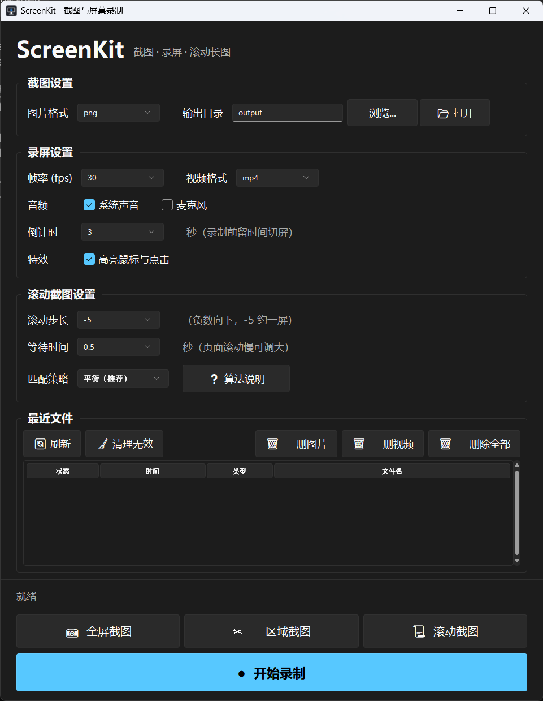

# ScreenKit 🖥️📸🎬

**ScreenKit** 是一款基于 Python 开发的现代化 Windows 截图与屏幕录制工具。它不仅支持常规的全屏/区域截图与录屏，还内置了**滚动长截图**、**音视频同步录制**、**标注编辑**、**鼠标特效**以及**系统托盘常驻**等高级功能。界面采用现代深色主题设计，旨在为你提供轻量、高效、且完全免费的生产力体验。

> 💡 **本项目采用纯 Python 开发**，底层结合了 `mss`（极速截屏）、`PyAV`（视频编码）、`OpenCV`（图像拼接与处理）以及 `Tkinter` 和 `sv-ttk`（现代化 GUI）。

---

## ✨ 核心特性

### 1. 全能的截图体验
- **多种截图模式**：支持全屏截图、自由区域截图。
- **滚动长截图**：内置智能图像拼接算法，自动识别重叠区域，完美捕捉超长网页或长文档。
- **快速标注编辑器**：截图后自动弹出编辑器，支持**矩形框选、箭头指示、马赛克打码、添加文字**，支持撤销操作。
- **自动复制剪贴板**：截图保存后，图片会自动复制到系统剪贴板，随时 `Ctrl+V` 粘贴发送。

### 2. 专业的屏幕录制
- **音画同步**：支持录制系统声音（WASAPI Loopback）与麦克风声音，自动混音。
- **录屏参数自定义**：自定义帧率（FPS）、视频格式（MP4 / AVI / WMV）。
- **倒计时录制**：录制前可选择 3/5/10 秒倒计时，留出切屏准备时间。
- **录屏悬浮条**：录制时显示半透明悬浮控制条，支持**暂停/恢复**、随时停止，且计时器完美同步。
- **鼠标特效**：录制时可开启鼠标高亮圈与点击水波纹，非常适合制作教学或演示视频。

### 3. 贴心的交互与工程化
- **全局快捷键**：在任意软件界面下，一键呼出截图或录制。
- **系统托盘常驻**：关闭主窗口时自动隐藏至系统托盘，右键托盘图标即可快速操作。
- **历史记录管理**：内置最近文件列表，支持双击打开、防同名冒充检测，以及一键清理无效/全部/分类文件。
- **偏好持久化**：自动记住你的输出目录、格式、FPS 等设置。

---

## 🖼️ 界面预览
<div align="left">
  
</div>

---

## 🚀 快速开始

### 1. 环境要求
- **操作系统**：Windows 10 / 11 (64 位)
- **Python**：3.10 或更高版本
- **FFmpeg**：用于视频转码与音频合成

### 2. 源码运行
1. **克隆仓库**：
   ```bash
   git clone https://github.com/GongHuilin-DL/ScreenKit.git
   cd ScreenKit
   ```

2. **创建虚拟环境并安装依赖**：
   ```bash
   python -m venv .venv
   .venv\Scripts\activate
   pip install -r requirements.txt
   ```

3. **配置 FFmpeg**：
   下载 `ffmpeg.exe`，将其放置在项目的 `tools/ffmpeg/` 目录下（如果目录不存在请创建），或确保 `ffmpeg` 已加入系统环境变量 `PATH` 中。

4. **启动应用**：
   ```bash
   python main.py
   ```

### 3. 打包为独立 EXE
项目已经配置好了 PyInstaller 的 spec 文件。执行以下命令即可在 `dist/ScreenKit/` 中生成独立运行的程序：
```bash
pyinstaller ScreenKit.spec --noconfirm --clean
```
*(注意：分发时请将整个 `ScreenKit` 文件夹打包发送，因为程序依赖 `_internal` 目录下的环境。)*

---

## ⌨️ 全局快捷键

| 快捷键 | 功能描述 |
| :--- | :--- |
| `Ctrl + Shift + S` | **全屏截图**（直接弹出标注编辑器） |
| `Ctrl + Shift + A` | **区域截图**（鼠标拖拽框选后弹出编辑器） |
| `Ctrl + Shift + R` | **开始 / 停止录制**（呼出录制控制） |

---

## 📂 项目结构

```text
ScreenKit/
├─ app/
│  ├─ controllers/      # 业务逻辑编排（截图、录屏流程控制）
│  ├─ core/             # 核心能力（捕获、编码、音频、导出、滚动拼接）
│  ├─ infra/            # 基础设施（日志、配置、路径、事件总线）
│  └─ ui/               # GUI 界面（Tkinter、悬浮条、编辑器、历史面板）
├─ config/              # 默认配置与用户配置持久化
├─ tools/               # 工具脚本与 ffmpeg.exe
├─ assets/              # 图标等静态资源
├─ main.py              # 程序入口
└─ ScreenKit.spec       # PyInstaller 打包配置
```

---

## ⚠️ 常见问题与限制 (FAQ)

**1. 录制的视频没有声音？**
请确保录制时勾选了“系统声音”。部分音频播放器（如某些专业播放器）如果开启了“独占模式”，会导致无法抓取 Loopback 音频，请在播放器设置中关闭“独占模式”。

**2. 滚动截图拼接有重影或断层？**
滚动截图非常依赖画面静止。如果目标网页/软件带有复杂的动态广告或固定的悬浮窗，可能会影响匹配算法。建议在侧边栏设置中适当调大“等待时间”（例如 0.8 秒）。

**3. 打包后在其他电脑上运行报错？**
如果提示缺少 `VCRUNTIME140.dll` 或 `MSVCP140.dll`，是因为目标电脑缺少微软 C++ 运行库。请下载并安装 [Microsoft Visual C++ Redistributable](https://aka.ms/vs/17/release/vc_redist.x64.exe)。

**4. 为什么找不到历史记录的实体文件？**
如果你在界面上移动了文件，或者用同名文件替换了原来的文件，为了安全起见，历史记录面板会将其标记为“❌ 已丢失”。可以通过面板上的“清理无效”按钮进行清理。

---

## 🤝 贡献与致谢

本项目在开发过程中参考并使用了以下优秀的开源库，在此表示衷心感谢：
- [mss](https://github.com/BoboTiG/python-mss) - 极速截屏
- [PyAV](https://github.com/PyAV-Org/PyAV) - FFmpeg 的 Python 绑定
- [OpenCV](https://opencv.org/) - 图像处理与匹配
- [sv-ttk](https://github.com/rdbende/Sun-Valley-ttk-theme) - 现代化 Tkinter 主题
- [pynput](https://github.com/moses-palmer/pynput) - 全局键鼠监听
- [soundcard](https://github.com/bastibe/SoundCard) - WASAPI 音频抓取

欢迎提交 Issue 或 Pull Request 来一起完善这个工具！

---

## 📄 开源协议

本项目基于 [MIT License](LICENSE) 协议开源。你可以自由使用、修改和分发。

---
*如果这个项目帮到了你，欢迎点一个 ⭐ Star！*

---

### 💡 发布前的小建议：
1. 在项目根目录下创建一个名为 `LICENSE` 的文件，将 MIT 协议的内容复制进去。
2. 用之前做好的软件界面截图（主界面、标注界面、长截图效果）替换掉文档里 `🖼️ 界面预览` 部分的占位符。
3. 记得把 GitHub 仓库的 `About` 描述写上：`一款功能强大的 Windows 截图与录屏工具，支持长截图、标注、音画同步及鼠标特效。`

祝你的开源分享顺利！如果后续在使用中遇到任何小 Bug，或者想增加新的功能，随时可以回来找我一起探讨。